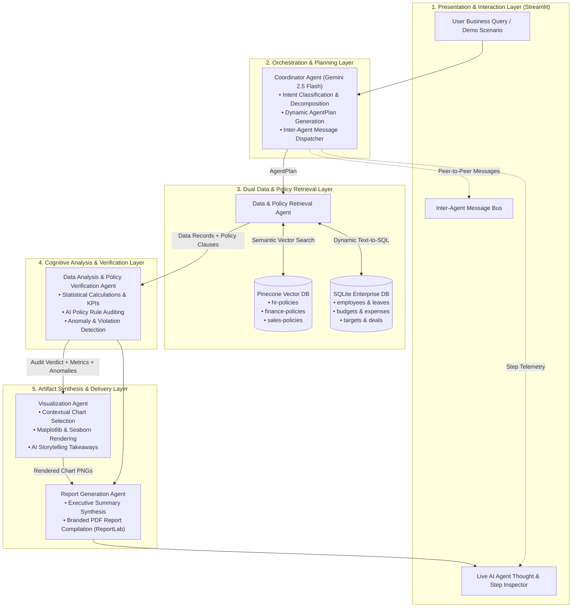
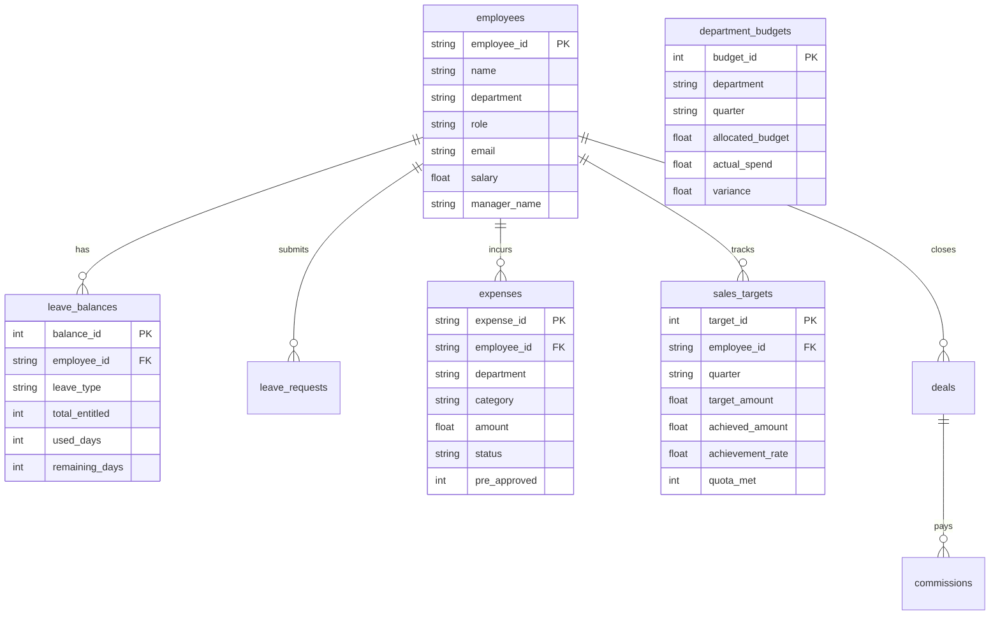

# 📊 Multi-Agent AI Workflow for Automated Business Intelligence & Policy Verification
## Comprehensive Project Architecture & End-to-End Technical Guide

---

## 🌟 Executive Summary

Modern enterprises generate vast amounts of structured data (ERP transactions, payroll, CRM leads, expense claims) alongside strict unstructured governance rules (HR policy manuals, travel reimbursement rules, sales commission schedules). 

Traditional Business Intelligence (BI) tools (like Tableau or PowerBI) suffer from three critical bottlenecks:
1. **Passive Dashboards**: They require human analysts to write SQL, clean data, and interpret charts.
2. **Ignorance of Company Governance**: Traditional BI computes raw sums and averages, but has no semantic understanding of whether an expense complies with company policy or whether an employee is eligible for a leave.
3. **Siloed Interaction**: Business executives and operational employees cannot simply ask plain-English questions and receive immediate, policy-verified answers with supporting charts and executive reports.

### The Solution: Autonomous Multi-Agent BI Architecture
This project implements an autonomous **Multi-Agent AI Workflow** powered by **Google Gemini (`gemini-2.5-flash`)** and **Pinecone Vector Database**. A team of specialized AI agents collaborate sequentially—acting like an automated data engineering team, policy compliance officer, data analyst, graphic designer, and executive strategist rolled into one.

```
┌─────────────────┐      ┌─────────────────────────┐      ┌───────────────────────────────────┐
│   User Prompt   │ ───► │    Coordinator Agent    │ ───► │ Dual Retrieval (Pinecone + SQLite)│
└─────────────────┘      └─────────────────────────┘      └─────────────────┬─────────────────┘
                                                                            │
┌─────────────────────────┐      ┌─────────────────────────┐                │
│  Report & PDF Exporter  │ ◄─── │   Visualization Agent   │ ◄──────────────┘
│  (ReportLab Synthesizer)│      │  (Matplotlib & Seaborn) │     (Analysis & Policy Audit)
└─────────────────────────┘      └─────────────────────────┘
```

---

## 🏗️ End-to-End System Architecture

The workflow follows a 6-phase pipeline connecting unstructured policy vectors, relational databases, cognitive reasoning, and visual outputs:



---

## 🤖 The 5 Specialized AI Agents

Each agent in the pipeline possesses a distinct AI persona, system prompt, and set of responsibilities:

### 1. Coordinator Agent (`app/agents/coordinator.py`)
- **Role**: Chief Operations Officer & Orchestration Engine.
- **How it works**:
  - Receives the raw user input (e.g., *"How many leaves are left for Malav Patel and can he take 3 consecutive casual leaves?"*).
  - Invokes Google Gemini with a structured system prompt to formulate an **`AgentPlan`**:
    - **Department**: `hr`, `finance`, or `sales`.
    - **Workflow Mode**: `employee_self_service` (personal operational lookup) vs. `executive_bi` (high-level department review).
    - **Target Entities**: Identifies specific names, quarters, or expense thresholds.
    - **SQL & Policy Strategy**: Decides which database tables and policy namespaces are required.
  - Broadcasts step updates and dispatches instructions across the inter-agent message bus.

### 2. Data & Policy Retrieval Agent (`app/agents/retrieval_agent.py`)
- **Role**: Senior Data Engineer & Policy Knowledge Specialist.
- **Dual Retrieval Capabilities**:
  1. **Semantic Policy Retrieval**: Connects to the Pinecone index (`minor-project-aavenix-policies`) using the target department namespace (`hr-policies`, `finance-policies`, `sales-policies`) and retrieves relevant governing policy clauses with similarity scoring.
  2. **AI Text-to-SQL Generation**: Inspects the 8 tables of the enterprise SQLite database and uses Gemini to write a syntactically valid SQLite `SELECT` query on the fly, extracting the precise rows needed without manual query authoring.

### 3. Data Analysis & Policy Verification Agent (`app/agents/analysis_agent.py`)
- **Role**: Principal Business Intelligence Analyst & Compliance Auditor.
- **Cognitive Capabilities**:
  - **Empirical Statistics**: Computes sums, averages, utilization rates, quota attainments, and budget variances using Pandas.
  - **AI Policy Cross-Examination**: Feeds empirical rows and Pinecone policy text into Gemini to perform a strict compliance audit:
    - *HR*: Verifies whether requested leave days exceed available balances and flags advance notice requirements (e.g. casual leaves $>3$ days require 5 days prior notice).
    - *Finance*: Detects expense violations (e.g., $180 client dinners without pre-approval, or unauthorized business class flight upgrades).
    - *Sales*: Identifies reps achieving $\ge 100\%$ quota and calculates commission accelerator bonuses (10% to 12% tiers).
  - Assigns an audit status: **`COMPLIANT`**, **`FLAGGED_VIOLATIONS`**, or **`REQUIRES_APPROVAL`**.

### 4. Visualization Agent (`app/agents/visualization_agent.py`)
- **Role**: Visual Analytics Architect & Data Storyteller.
- **Visual Capabilities**:
  - Automatically selects the optimal chart type based on data context:
    - **Leave Balances**: Horizontal Bar Chart comparing Entitled vs. Used vs. Remaining days.
    - **Department Expenses**: Stacked Bar Chart highlighting policy-flagged amounts in red.
    - **Budget vs. Spend**: Grouped Column Chart showing allocation vs. actual burn rate.
    - **Sales Performance**: Dual Column Chart showing quota target vs. achieved revenue with milestone labels.
  - Uses Gemini to formulate a 1-sentence **Executive Narrative Takeaway** explaining the business implication of the chart.
  - Saves high-resolution PNG images to `app/data/exports/charts/`.

### 5. Report Generation Agent (`app/agents/report_agent.py`)
- **Role**: Chief Strategy Officer & Executive Report Synthesizer.
- **Deliverables**:
  - **Branch A (Employee Self-Service)**: Generates a concise, polite, and policy-grounded guidance card with direct answers, exact leave/claim numbers, policy citations, and explicit next steps.
  - **Branch B (Executive BI Report)**: Synthesizes an executive report featuring:
    - Executive Summary
    - Policy Compliance Verdict & Flagged Anomalies
    - Key Performance Indicator (KPI) Matrix
    - Embedded Visualizations with Narrative Takeaways
    - Prioritized Strategic Recommendations
  - Compiles a publication-ready **PDF Document** using ReportLab (`app/tools/pdf_builder.py`).

---

## 🗄️ Enterprise Data Infrastructure

### 1. Relational Database (`app/data/company_data.sqlite`)
Generated automatically via `app/tools/db_generator.py` with 8 interconnected business tables:



### 2. Pinecone Vector Knowledge Base
- **Index**: `minor-project-aavenix-policies`
- **Embedding Model**: `llama-text-embed-v2` / `text-embedding-004`
- **Namespaces**:
  - `hr-policies`: Leave entitlements, notice periods, working hours, and medical certificate rules.
  - `finance-policies`: Travel per-diem limits ($50/day solo, $150 client dinner with pre-approval), flight travel class rules (Economy only unless $>8$ hours with CFO approval), hardware purchase limits.
  - `sales-policies`: Commission structures (8% base, 10%-12% quota accelerator), discount authorization matrix.

---

## 🎯 Dual-Audience Use Cases

| Capability | Persona: Operational Employee | Persona: Business Executive / Manager |
| :--- | :--- | :--- |
| **Primary Goal** | Fast, accurate, policy-checked answers to personal queries. | Strategic oversight, budget tracking, anomaly audits, executive reports. |
| **Example Query** | *"How many leaves are left for Malav Patel and can I take 3 consecutive casual leaves?"* | *"Analyze all submitted Q3 expenses, audit compliance against reimbursement policy, and flag violations."* |
| **Output Type** | Direct guidance card with policy citation & remaining balance. | Full Executive BI Dashboard, anomaly alerts, KPI table, charts, and downloadable PDF report. |

---

## 🔍 Presentation & Observability Features

Designed specifically for presentations and academic evaluation, the Streamlit interface provides complete transparency into the multi-agent system:

1. **Step-by-Step AI Agent Execution Inspector**:
   - Every single agent step is displayed as an expandable card with start/end timestamps and status badges.
   - Shows the exact SQL query written by Gemini and the raw rows retrieved from SQLite.
   - Displays retrieved Pinecone policy snippets and similarity scores.
2. **AI Cognitive Reasoning Box (Chain-of-Thought)**:
   - Reveals the internal `<thought>` block of each agent, showing *why* the AI made each decision before executing.
3. **Inter-Agent Message Bus Tab**:
   - A live chat log showing agents communicating with each other (e.g. `Coordinator ➔ RetrievalAgent`, `RetrievalAgent ➔ AnalysisAgent`).
4. **1-Click Presentation Demo Presets**:
   - Pre-configured demo scenarios in the sidebar for smooth live presentations:
     - *Scenario 1 (HR)*: Malav Patel Leave Inquiry (Self-Service)
     - *Scenario 2 (Finance)*: Expense Policy Audit & Violations (BI)
     - *Scenario 3 (Finance)*: Budget Allocation vs. Actual Spend (BI)
     - *Scenario 4 (Sales)*: Q3 Target & Commission Accelerator (BI)

---

## 📂 Repository Directory Layout

```
Multi-Agent-BI-Workflow/
├── .env                               # GOOGLE_API_KEY, PINECONE_API_KEY, PINECONE_INDEX_NAME
├── README.md                          # Quickstart documentation
├── PROJECT_GUIDE.md                   # This comprehensive technical guide
├── requirements.txt                   # Production dependencies
├── app/
│   ├── __init__.py                    # App package marker
│   ├── main.py                        # CLI entrypoint with real-time step logger
│   ├── ui.py                          # Streamlit presentation dashboard
│   ├── config/
│   │   ├── __init__.py
│   │   ├── settings.py                # Global directories, model parameters, API keys
│   │   └── departments.py             # Department configurations & Pinecone namespaces
│   ├── schema/
│   │   ├── __init__.py
│   │   └── state.py                   # Pydantic schemas: WorkflowState, WorkflowStep, AgentPlan, AgentMessage
│   ├── retrieval/
│   │   ├── __init__.py
│   │   ├── pinecone_retriever.py      # Pinecone semantic policy retriever with fallback
│   │   └── sql_retriever.py           # SQLite database query executor & schema inspector
│   ├── agents/
│   │   ├── __init__.py
│   │   ├── base_agent.py              # Base workflow agent with step telemetry & messaging
│   │   ├── llm_service.py             # GeminiAgentBrain (Gemini 2.5 Flash, reasoning extraction)
│   │   ├── coordinator.py             # Master Coordinator Agent (Dynamic planning & routing)
│   │   ├── retrieval_agent.py         # Data & Policy Retrieval Agent (Dynamic Text-to-SQL + Pinecone)
│   │   ├── analysis_agent.py          # Data Analysis Agent (Pandas stats + Cognitive policy audit)
│   │   ├── visualization_agent.py     # Visualization Agent (Matplotlib/Seaborn + AI narrative)
│   │   └── report_agent.py            # Report Generation Agent (Executive synthesis + PDF export)
│   ├── tools/
│   │   ├── __init__.py
│   │   ├── db_generator.py            # Synthetic enterprise SQLite DB & sample CSV generator
│   │   ├── chart_tools.py             # Matplotlib & Seaborn chart rendering functions
│   │   └── pdf_builder.py             # ReportLab executive PDF report compiler
│   └── data/
│       ├── company_data.sqlite        # Enterprise SQLite relational database
│       ├── samples/                   # Pre-exported CSV datasets (HR, Finance, Sales)
│       └── exports/                   # Output storage for generated chart PNGs and PDF reports
```

---

## 🚀 Setup & Execution Guide

### 1. Environment Configuration
Verify that your `.env` file in the project root contains:
```env
GOOGLE_API_KEY=your_gemini_api_key_here
PINECONE_API_KEY=your_pinecone_api_key_here
PINECONE_INDEX_NAME=minor-project-aavenix-policies
```

### 2. Dependency Installation
```bash
pip install -r requirements.txt
```

### 3. Database Initialization (Optional Reset)
The database is initialized automatically. To reset or re-seed the SQLite database:
```bash
python -m app.tools.db_generator
```

### 4. Running the Interactive Presentation Dashboard
```bash
streamlit run app/ui.py
```
*Open your browser to `http://localhost:8501`. Use the sidebar to trigger demo scenarios or enter any natural language question.*

### 5. Running via Terminal CLI
```bash
python app/main.py --query "How many leaves are left for Malav Patel?"
```

---

## 🔮 Future Enhancements

1. **Production Data Warehouse Connectors**: Extending the Retrieval Agent with connectors for Snowflake, BigQuery, and Databricks.
2. **Streaming AI Thoughts**: Real-time token streaming of agent reasoning directly into the UI via WebSockets.
3. **Conversational Multi-Turn Memory**: Enabling drill-down conversations (e.g. *"Why did travel expenses spike in Q2?"* followed by *"Break that down by employee"*).
